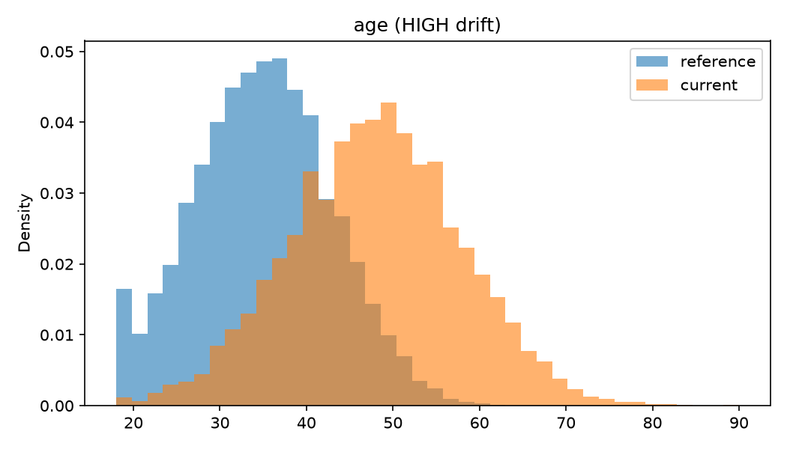
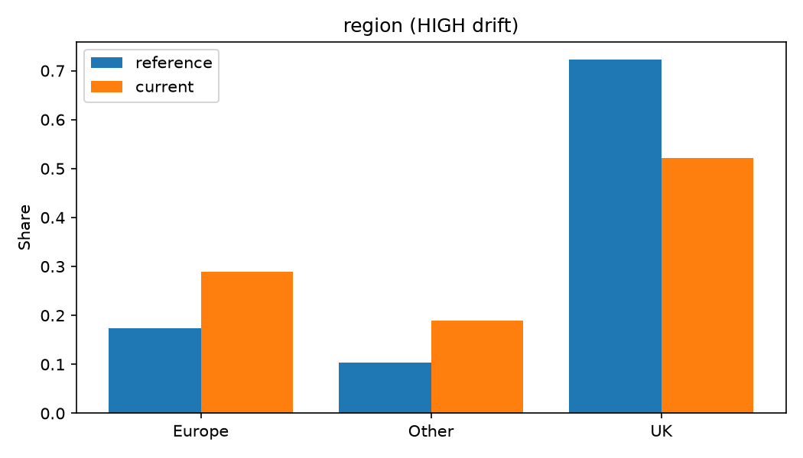

# Data Drift Monitor

A reusable command-line tool that compares a reference dataset (what a model was trained on) against current data (what the system receives now) and reports whether the data's distributions have changed — before that change silently degrades a deployed model.

## Why drift matters

A trained model keeps producing predictions even when the world it was trained on no longer exists. If customers' ages, incomes or regions shift over six months, the model still runs — it just quietly answers questions about a population that is no longer the one at the door. Detecting that situation is a data problem, not a model problem, which is why this tool needs no model at all.

Two distinct ideas are worth separating:

- **Data drift** — the input distribution changes (what this tool detects);
- **Concept drift** — the relationship between inputs and the target changes, which can happen even when the inputs look identical. Detecting it requires labels or model-performance feedback, and is out of scope for version one.

## What the tool checks

```text
reference.csv          current.csv
      └──────┬───────────────┘
             ▼
   1. Schema: missing / new columns, type mismatches, row counts
   2. Missingness: per-column missing-value rates and changes
   3. Numeric drift: KS statistic + p-value, Wasserstein distance, means/SDs
   4. Categorical drift: per-category share changes
   5. LOW / MODERATE / HIGH classification per feature
```

- **Kolmogorov–Smirnov statistic** ([driftwatch/numeric.py](driftwatch/numeric.py)) — the largest vertical gap between the two empirical cumulative distributions. Bigger means the shapes differ more. The p-value is displayed for information only: with ~10,000 rows, utterly trivial differences become "statistically significant", so classification is always based on effect magnitude.
- **Wasserstein distance** — informally, how far probability mass must be moved to turn one distribution into the other, in the column's own units. Divided by the reference standard deviation it becomes a scale-free shift (a value of 1.0 means the distribution has moved by a whole standard deviation).
- **Category share change** ([driftwatch/categorical.py](driftwatch/categorical.py)) — the largest absolute change in any category's proportion. Simple, interpretable, and counts appearing/disappearing categories at full weight.

Thresholds (in [driftwatch/numeric.py](driftwatch/numeric.py) and [driftwatch/categorical.py](driftwatch/categorical.py), overridable per call) are configurable heuristics combining statistical evidence with magnitude of change — there is no universally correct cut-off, and the defaults are documented rather than pretended to be laws.

## Setup and usage

Requires Python 3.11+ (developed and tested on 3.14).

```powershell
python -m venv .venv
.\.venv\Scripts\python.exe -m pip install -r requirements.txt

# Regenerate the controlled example data
python generate_data.py

# Compare two datasets
python main.py data/reference.csv data/current_drifted.csv

# Also save distribution plots for the flagged features
python main.py data/reference.csv data/current_drifted.csv --plots results

# Run the tests
python -m pytest tests
```

## The controlled experiment

[generate_data.py](generate_data.py) creates three datasets with known ground truth:

| Dataset | Contents |
|---------|----------|
| `reference.csv` | 10,000 rows: age ~ N(35, 8), income ~ N(35000, 12000), region 72/18/10% UK/Europe/Other, 1.2% missing income |
| `current_normal.csv` | 9,500 rows drawn from the same distributions (different seed) |
| `current_drifted.csv` | 8,400 rows with planted drift: age ~ N(48, 10), income mean 49,000, region 51/29/20%, 8.7% missing income |

`device_type` and `account_age` are left untouched in all three, as negative controls.

### Result: reference vs current_normal (should stay quiet — and does)

```text
Drift by feature:
  age            LOW       KS 0.009  p 0.803  shift 0.01 SD  (mean 34.9 -> 34.9)
  income         LOW       KS 0.015  p 0.247  shift 0.03 SD  (mean 34,881.8 -> 35,190.2)
  region         LOW       max category share change 0.5%
  device_type    LOW       max category share change 0.8%
  account_age    LOW       KS 0.016  p 0.143  shift 0.02 SD  (mean 592.5 -> 599.7)

Overall: 0 / 5 features show drift (HIGH or MODERATE)
```

### Result: reference vs current_drifted (should flag the planted changes — and does)

```text
Missing data:
  income         ref  1.2%  cur  7.9%  change +6.6%  WARNING

Drift by feature:
  age            HIGH      KS 0.538  p 0  shift 1.65 SD  (mean 34.9 -> 48.0)
  income         HIGH      KS 0.440  p 0  shift 1.16 SD  (mean 34,881.8 -> 48,914.3)
  region         HIGH      max category share change 20.2%
  device_type    LOW       max category share change 0.9%
  account_age    LOW       KS 0.013  p 0.425  shift 0.02 SD  (mean 592.5 -> 600.9)

HIGH: age, income, region
Overall: 3 / 5 features show drift (HIGH or MODERATE)
```

Exactly the three planted drifts are flagged HIGH, the missing-income jump triggers a warning, and both negative controls stay LOW. No false positives on the clean comparison, no false negatives on the drifted one.





## Significance versus importance

The clean comparison shows why classification never uses p-values: with ~10,000 rows per side, the KS test's p-values bounce around freely (0.14–0.80 here) on identical distributions, and with big enough samples they routinely fall below 0.05 for differences too small to matter. The drift levels are therefore driven by the KS statistic and the SD-normalised Wasserstein shift — measures of *how much* the distributions differ, not how *confidently* they differ.

## Tests

17 pytest tests cover identical datasets, strong numeric and categorical shifts, moderate shifts, missing and extra columns, dtype mismatches, NaN handling, constant columns, all-NaN columns and empty-dataset errors.

## Limitations

- Univariate only: each feature is checked independently, so correlated drift that leaves the marginals unchanged is invisible.
- Thresholds are heuristics; sensible values depend on the domain and cost of false alarms.
- Categorical comparison uses maximum share change, which ignores changes spread across many small categories (Jensen–Shannon distance would capture these).
- No timestamps: the tool compares two snapshots, not a continuous stream.

## Future extensions

- Jensen–Shannon distance for categorical columns.
- JSON report output for machine consumption and alerting.
- Continuous or windowed monitoring rather than snapshot comparison.
- Model-performance (concept-drift) monitoring when labels are available.
- Multivariate drift detection (for example on model embeddings or PCA projections).
